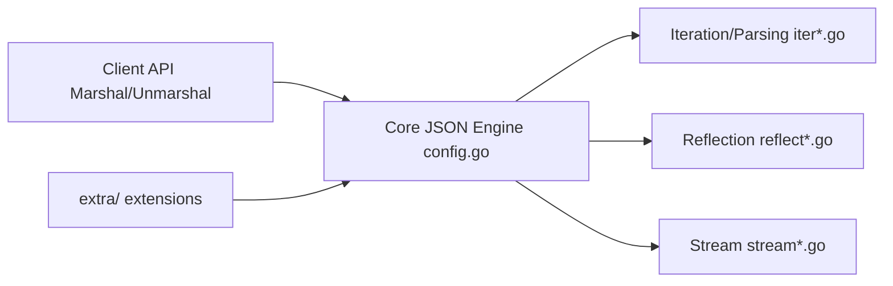

# json-iterator/go

> Drop-in, faster replacement for encoding/json in Go, for Go developers.

## The problem
Go's standard JSON package is slow and allocates heavily on demanding workloads.

## What it actually does
Provides `jsoniter.ConfigCompatibleWithStandardLibrary`, which replaces `json.Marshal` and `json.Unmarshal`. The README gives a benchmark: decoding 5,623 ns/op versus 35,510 for the standard lib on a medium payload, with the caveat to test your own workload. The code combines an iterator-based parser, reflection, streams and extensions.

## How it is wired


## Trying it
```bash
go get github.com/json-iterator/go
```
```go
import jsoniter "github.com/json-iterator/go"
var json = jsoniter.ConfigCompatibleWithStandardLibrary
json.Marshal(&data)
```

## Cost and gotchas
Free. Archived repository, last push on 2024-05-27, 272 open issues with no possible follow-up.

## What it is not
Not maintained: fixes will no longer come. The gain depends heavily on the data.

## Alternatives
easyjson, compared in the benchmark: static code generation, decoding faster than the standard lib.

## For you
Ignore: archived and old; for a Go service, rather measure the options that are still alive.
