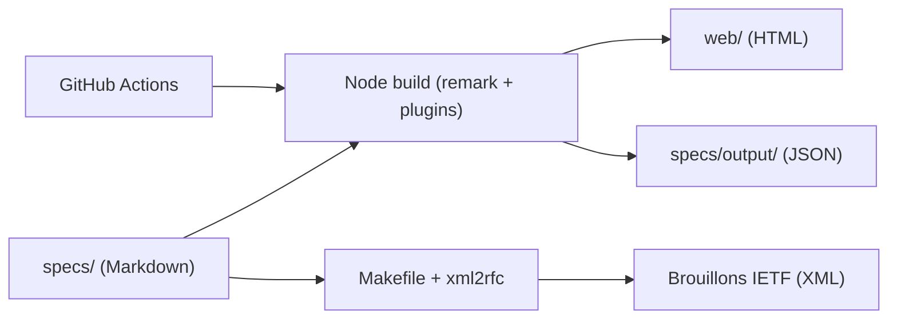

# json-schema-org/json-schema-spec

> Sources of the upcoming IETF drafts of the JSON Schema specification, for reviewers and implementers.

## The problem
Validating and documenting JSON documents requires a common vocabulary, published and versioned.

## What it actually does
Working repository of the specifications in Markdown (`specs/`), with architecture decisions (`adr/`). A Node toolchain (remark, rehype and in-house plugins) produces the HTML and JSON outputs; a Python toolchain (Makefile, xml2rfc) produces the IETF drafts. GitHub Actions CI. Meta-schema tests with `npm test`.

## How it is wired


## Trying it
```bash
npm run build -- specs
npm run build -- specs/jsonschema-core.md
npm run build-ietf
npm test
```

## Cost and gotchas
Free. Published versions are on the project website, not in this working repository. License "present but unidentified": read it before reusing the text.

## What it is not
Not a validation library: the conformance tests and the website have their own repositories.

## Alternatives
No alternative named in the README.

## For you
Worth watching: consult it as a reference when you write data or configuration schemas; no need to clone it except to contribute.
