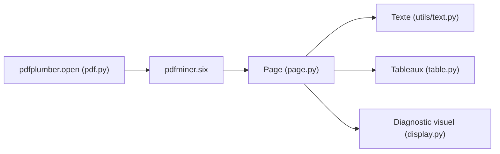

# jsvine/pdfplumber

> Python library that extracts text, tables and objects from machine-generated PDFs, with visual debugging.

## The problem
Cleanly extracting tables and positioned text from a PDF is tedious, and you can't see why the extraction fails.

## What it actually does
Built on `pdfminer.six`, it exposes every character, line, rectangle, curve, image and link as dictionaries. It extracts text (with optional layout), words, regex searches, and tables (`lines`, `text`, `explicit` strategies). `to_image()` draws the detected objects so you can tune the parameters. A CLI outputs CSV, JSON or text.

## How it is wired


## Trying it
```bash
pip install pdfplumber
curl "https://raw.githubusercontent.com/jsvine/pdfplumber/stable/examples/pdfs/background-checks.pdf" > background-checks.pdf
pdfplumber background-checks.pdf > background-checks.csv
```

## Cost and gotchas
Free. The page cache can use a lot of memory on large PDFs: `Page.close()` releases it. Some attributes are marked experimental in the README.

## What it is not
Not an OCR: it works poorly on scanned PDFs. It neither generates nor modifies PDFs. Forms have no dedicated interface.

## Alternatives
pymupdf (faster, but AGPL license and MuPDF dependency), camelot, tabula-py and pdftables (table-focused), pdfminer.six (base only), PyPDF2.

## For you
Adopt: the reference tool for feeding a data pipeline with tables from machine-generated PDFs, with visual debugging that saves time.
