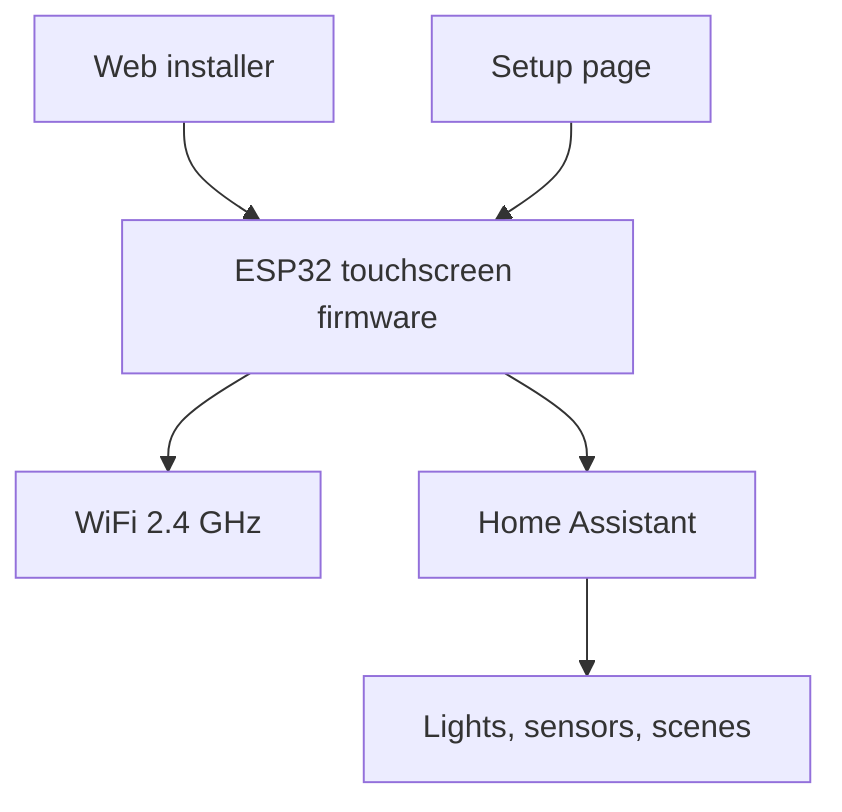

# jtenniswood/espcontrol

> Firmware for an ESP32 touchscreen that serves as a Home Assistant control panel, no code needed.

## The problem
Everyday home automation controls go through the Home Assistant app, which is impractical for family or guests.

## What it actually does
Firmware installed from the browser (Chrome or Edge, USB-C cable). The screen joins the 2.4 GHz WiFi, Home Assistant discovers it, then a built-in web page lets you compose button pages by drag and drop. About thirty card types (lights, sensors, climate, camera, media, alarm, etc.). Sleep, brightness, backup and restore, automatic updates.

## How it is wired


## Trying it
Installation goes through the online guide; only contributor commands appear in the README:
```bash
npm run check:product
npm run check:fast
npm run check:web-browser-smoke
npm run docs:build
```

## Cost and gotchas
Hardware: a supported ESP32 screen must be purchased (list not provided here). Home Assistant is required on the local network. No cloud. 111 open issues.

## What it is not
Not a generic dashboard: it only works with Home Assistant. License not identified by GitHub. No architecture derived from the code provided.

## Alternatives
None cited in the README.

## For you
Ignore: home automation, unrelated to your data/AI/MLOps profile, and the license needs checking.
