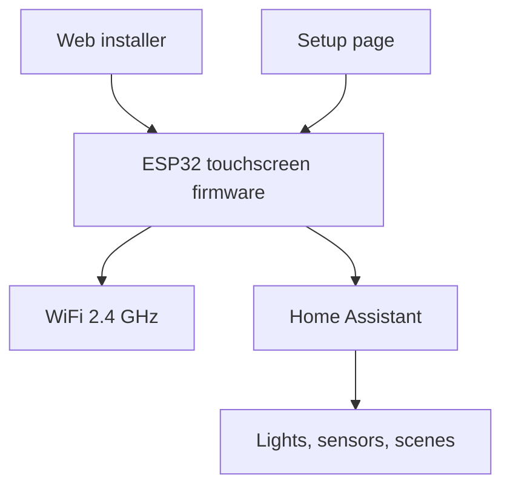

# jtenniswood/espcontrol

> Firmware pour écran tactile ESP32 qui sert de panneau de commande Home Assistant, sans code.

## Le problème
Les commandes domotiques courantes passent par l'appli Home Assistant, peu pratique pour la famille ou les invités.

## Ce que ça fait vraiment
Firmware installé depuis le navigateur (Chrome ou Edge, câble USB-C). L'écran rejoint le WiFi 2,4 GHz, Home Assistant le découvre, puis une page web intégrée permet de composer des pages de boutons en glisser-déposer. Une trentaine de types de cartes (lumières, capteurs, climat, caméra, média, alarme, etc.). Veille, luminosité, sauvegarde et restauration, mises à jour automatiques.

## Comment c'est branché


## Essayer
Installation via le guide en ligne ; seules les commandes de contributeur figurent dans le README :
```bash
npm run check:product
npm run check:fast
npm run check:web-browser-smoke
npm run docs:build
```

## Coût et pièges
Matériel : écran ESP32 pris en charge à acheter (liste non fournie ici). Home Assistant requis sur le réseau local. Pas de cloud. 111 issues ouvertes.

## Ce que ce n'est pas
Pas un tableau de bord générique : il ne sert qu'avec Home Assistant. Licence non identifiée par GitHub. Aucune architecture d'après le code fournie.

## Alternatives
Aucune citée dans le README.

## Pour toi
Ignorer : domotique, sans rapport avec ton profil data/IA/MLOps, et licence à vérifier.

