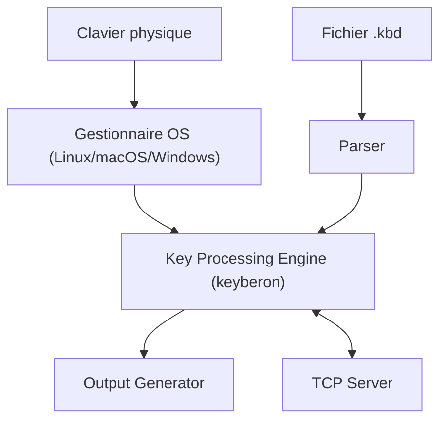

# jtroo/kanata

> Cross-platform software keyboard remapper with QMK-style layers, for Linux, macOS and Windows.

## The problem
Improve typing comfort on an ordinary keyboard, without QMK hardware.

## What it actually does
Kanata intercepts keystrokes and applies layers, tap-hold, macros, Unicode and Vim-style sequences. The configuration is a readable file, hot-reloaded. An optional TCP server lets other programs react to layer changes.

## How it is wired


## Trying it
```bash
cargo install kanata
kanata --cfg
# Linux, depuis les sources
git clone https://github.com/jtroo/kanata && cd kanata
cargo build
sudo target/debug/kanata --cfg
```

## Cost and gotchas
Free. On Linux and macOS you need sudo, and a Karabiner driver on macOS. It does not start in the background by itself. The `cmd` action requires the `--features cmd` feature.

## What it is not
It is not an application macro tool: it works at the key level. It does not run without elevated rights or a driver.

## Alternatives
- kmonad: a source of inspiration, written in Haskell.
- keyd: Linux-only remapper, close to kanata.
- karabiner-elements: macOS only.

## For you
Worth watching: typing comfort useful for a profile that codes a lot, but unrelated to data/AI.
