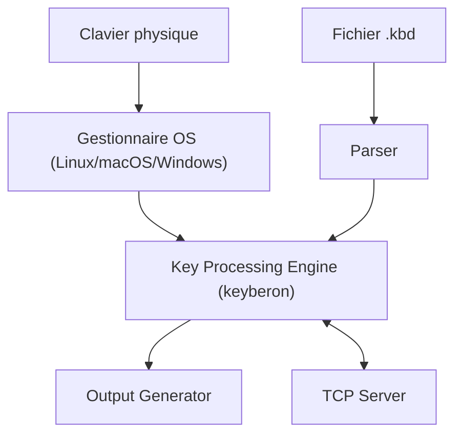

# jtroo/kanata

> Remappeur de clavier logiciel multiplateforme à couches, façon QMK, pour Linux, macOS et Windows.

## Le problème
Améliorer le confort de frappe sur un clavier ordinaire, sans matériel QMK.

## Ce que ça fait vraiment
Kanata intercepte les frappes et applique des couches, tap-hold, macros, Unicode et séquences de type Vim. La configuration est un fichier lisible, rechargé à chaud. Un serveur TCP facultatif permet à d'autres programmes de réagir aux changements de couche.

## Comment c'est branché


## Essayer
```bash
cargo install kanata
kanata --cfg
# Linux, depuis les sources
git clone https://github.com/jtroo/kanata && cd kanata
cargo build
sudo target/debug/kanata --cfg
```

## Coût et pièges
Gratuit. Sous Linux et macOS il faut sudo, et un pilote Karabiner sur macOS. Il ne se lance pas en arrière-plan de lui-même. L'action `cmd` demande la fonction `--features cmd`.

## Ce que ce n'est pas
Ce n'est pas un outil de macros d'application : il agit au niveau des touches. Il ne tourne pas sans droits élevés ou pilote.

## Alternatives
- kmonad : source d'inspiration, écrit en Haskell.
- keyd : remappeur Linux seulement, proche de kanata.
- karabiner-elements : macOS seulement.

## Pour toi
À surveiller : confort de frappe utile pour un profil qui code beaucoup, mais sans rapport avec data/IA.

