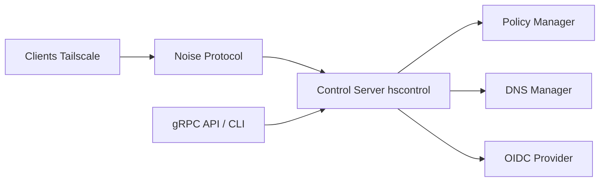

# juanfont/headscale

> Open source, self-hosted Tailscale control server, for a single private network of a lab or small team.

## The problem
Tailscale's control server is closed: linking machines through a WireGuard VPN forces you to go through the vendor's service.

## What it actually does
Headscale exchanges the nodes' WireGuard public keys, assigns their IP addresses, separates users, allows sharing machines and exposes advertised routes. It deliberately targets a single tailnet, for individuals, labs or small open source organizations. From the architecture: `hscontrol` control, Noise protocol, DERP, access policies, DNS, OIDC, gRPC API and CLI.

## How it is wired


## Trying it
```bash
nix develop
make generate
make test
make build
```

## Cost and gotchas
Free; container images and binaries exist, but the README says it neither supports nor encourages reverse proxies and containers. Use the tag of the version you run to get the right example configuration. An active maintainer is employed by Tailscale (contributions reviewed by the others).

## What it is not
Not affiliated with Tailscale Inc., and not a multi-tailnet service: the scope is narrow by design. The Windows/macOS/iOS graphical clients remain proprietary according to the README.

## Alternatives
- Tailscale: the official service, whose control server is closed.

## For you
Worth watching: useful for privately linking GPU machines and data servers without an account with the vendor, provided you accept running it yourself.
