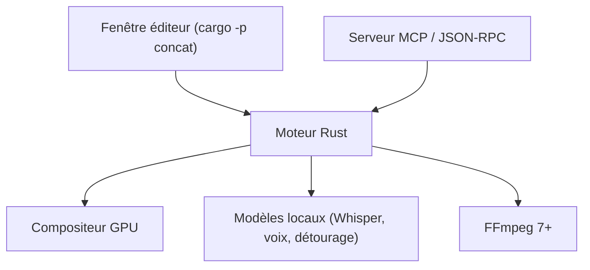

# jub0t/Concat

> Free, cross-platform, fully local video editor, with captions and voice from embedded models.

## The problem
Free video editors force a watermark, an account, or uploading your videos to the cloud for AI features.

## What it actually does
Native Rust engine with a GPU compositor: multitrack editing, keyframes, 100 effects, titles, H.264, HEVC, AV1 export up to 4K. Automatic captions via local Whisper, voice synthesis with cloning, background removal, audio cleanup. Built-in MCP server (`concat --mcp`) and JSON-RPC API for agents and scripts. Models are downloaded once.

## How it is wired

Diagram inferred from the README, no code diagram provided.

## Trying it
```bash
cd src
cargo run -p concat
cargo build --profile app -p concat
cargo test
```

## Cost and gotchas
Free. Beta: the README admits rough edges. Windows builds are unsigned (SmartScreen). Build: Rust 1.93+, FFmpeg 7+, cmake. Repo created in August 2026.

## What it is not
Not a stable production tool. No competitor is named. The AGPL requires sharing modifications when run as a network service.

## Alternatives
No alternative named in the README.

## For you
Worth watching: the MCP API lets an agent script video editing, but the project is very young and in beta.
