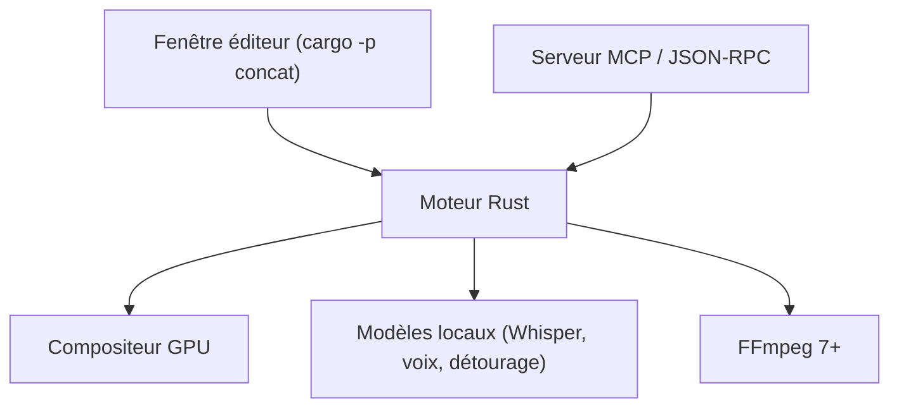

# jub0t/Concat

> Éditeur vidéo libre et multiplateforme, entièrement local, avec légendes et voix par modèles embarqués.

## Le problème
Les éditeurs vidéo gratuits imposent filigrane, compte ou envoi des vidéos dans le cloud pour les fonctions IA.

## Ce que ça fait vraiment
Moteur natif en Rust avec compositeur GPU : montage multipiste, keyframes, 100 effets, titres, export H.264, HEVC, AV1 jusqu'à 4K. Légendes automatiques via Whisper local, synthèse vocale avec clonage, détourage, nettoyage audio. Serveur MCP intégré (`concat --mcp`) et API JSON-RPC pour agents et scripts. Les modèles se téléchargent une fois.

## Comment c'est branché

Schéma déduit du README, sans diagramme de code fourni.

## Essayer
```bash
cd src
cargo run -p concat
cargo build --profile app -p concat
cargo test
```

## Coût et pièges
Gratuit. Bêta : le README admet des aspérités. Builds Windows non signés (SmartScreen). Compilation : Rust 1.93+, FFmpeg 7+, cmake. Dépôt créé en août 2026.

## Ce que ce n'est pas
Pas un outil de production stable. Aucun nom de concurrent n'est donné. L'AGPL impose le partage des modifications en service réseau.

## Alternatives
Aucune alternative nommée dans le README.

## Pour toi
À surveiller : l'API MCP permet de scripter du montage depuis un agent, mais le projet est très jeune et en bêta.

