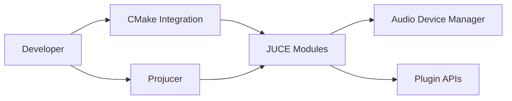

# juce-framework/JUCE

> Cross-platform C++ framework for desktop apps, mobile apps and audio plug-ins (VST, AU, AAX, LV2).

## The problem
Write an audio plug-in or an application once and ship it on several systems and formats.

## What it actually does
JUCE modules (UI, messages, audio devices, MIDI-CI, ARA, script engine), integrated through CMake or generated with the Projucer for Xcode, Visual Studio, Android Studio and Makefiles. API documentation generated by Doxygen, buildable examples, and tutorials in a separate repository.

## How it is wired


## Trying it
```bash
cmake . -B cmake-build -DJUCE_BUILD_EXAMPLES=ON -DJUCE_BUILD_EXTRAS=ON
cmake --build cmake-build --target DemoRunner
```

## Cost and gotchas
Dual license: AGPLv3 or a commercial JUCE license (a commercial license may be required for a closed-source product). GitHub does not identify the license: read LICENSE.md. AAX plug-ins require PACE signing.

## What it is not
Not an AI audio tool: an application framework. The Projucer is not provided pre-built.

## Alternatives
No alternative named in the README.

## For you
Ignore: only useful for developing audio plug-ins; the dual license weighs heavily if the product is closed-source.
