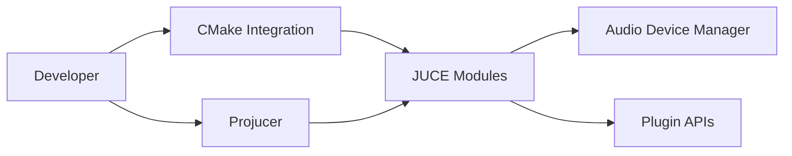

# juce-framework/JUCE

> Framework C++ multiplateforme pour applications de bureau, mobiles et plug-ins audio (VST, AU, AAX, LV2).

## Le problème
Écrire une seule fois un plug-in audio ou une application et le livrer sur plusieurs systèmes et formats.

## Ce que ça fait vraiment
Modules JUCE (interface, messages, périphériques audio, MIDI-CI, ARA, moteur de script), intégrés par CMake ou générés avec le Projucer pour Xcode, Visual Studio, Android Studio et Makefiles. Documentation d'API générée par Doxygen, exemples compilables, tutoriels dans un dépôt à part.

## Comment c'est branché


## Essayer
```bash
cmake . -B cmake-build -DJUCE_BUILD_EXAMPLES=ON -DJUCE_BUILD_EXTRAS=ON
cmake --build cmake-build --target DemoRunner
```

## Coût et pièges
Double licence : AGPLv3 ou licence commerciale JUCE (une licence commerciale peut être requise pour un produit fermé). GitHub n'identifie pas la licence : lire LICENSE.md. Les plug-ins AAX demandent une signature PACE.

## Ce que ce n'est pas
Pas un outil d'IA audio : un framework d'application. Le Projucer n'est pas fourni pré-compilé.

## Alternatives
Aucune alternative nommée dans le README.

## Pour toi
Ignorer : utile seulement pour développer des plug-ins audio ; la double licence pèse si le produit est fermé.

