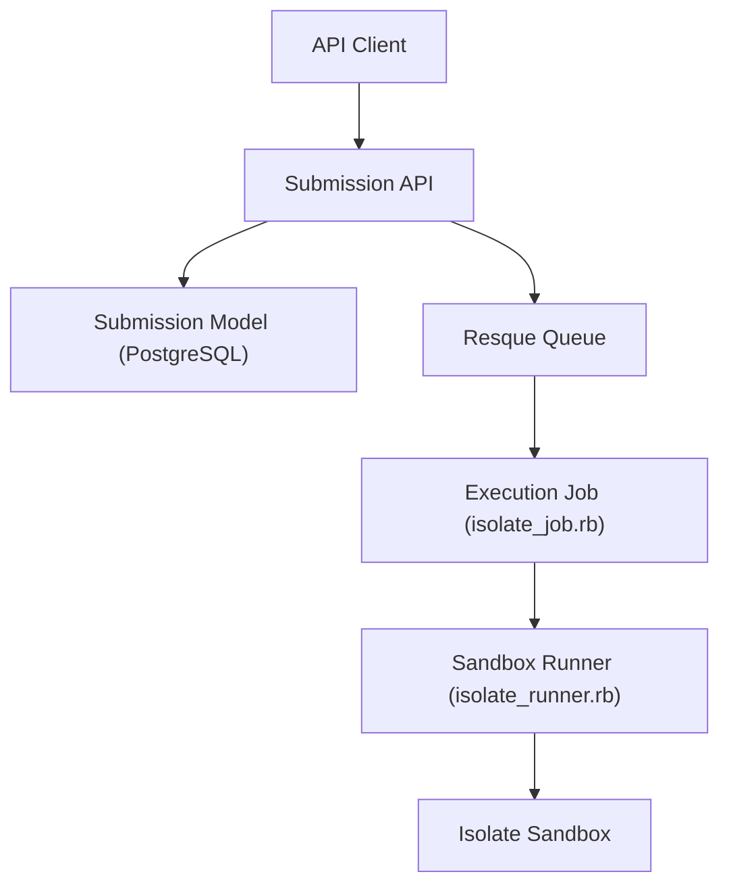

# judge0/judge0

> HTTP API for sandboxed code execution, for AI agents, exercise platforms and online editors.

## The problem
Run untrusted code (written by a user or by an LLM) without risk to the host machine.

## What it actually does
Receives source code, a language and limits over HTTP JSON, and runs it in an Isolate sandbox, either synchronously or through a Resque queue. More than 90 languages, multi-file projects, webhooks. Detailed results are stored in PostgreSQL. Self-hosted or managed service.

## How it is wired
Diagram taken from the one provided.



## Trying it
```bash
curl \
  -H "Content-Type: application/json" \
  -d '{
      "language_id": 109,
      "source_code": "print(f\"hello, {input()}\")",
      "stdin": "Alice"
  }' \
  "https://ce.judge0.com/submissions?wait=true"
pip install judge0
```

## Cost and gotchas
Self-hosting is free but you must secure it yourself: sandbox escapes (CVEs) are cited in the README's references, so keep it up to date. The managed service goes through RapidAPI or a contract. GPL-3.0 license (copyleft).

## What it is not
Not a code interpreter built into an LLM: it is a service you must deploy and harden. The README is mostly a list of references.

## Alternatives
No alternative named in the README (comparison articles with E2B and Rustbox are only listed).

## For you
Worth watching: handy for giving an agent a code sandbox, provided you isolate the network and follow security fixes.
