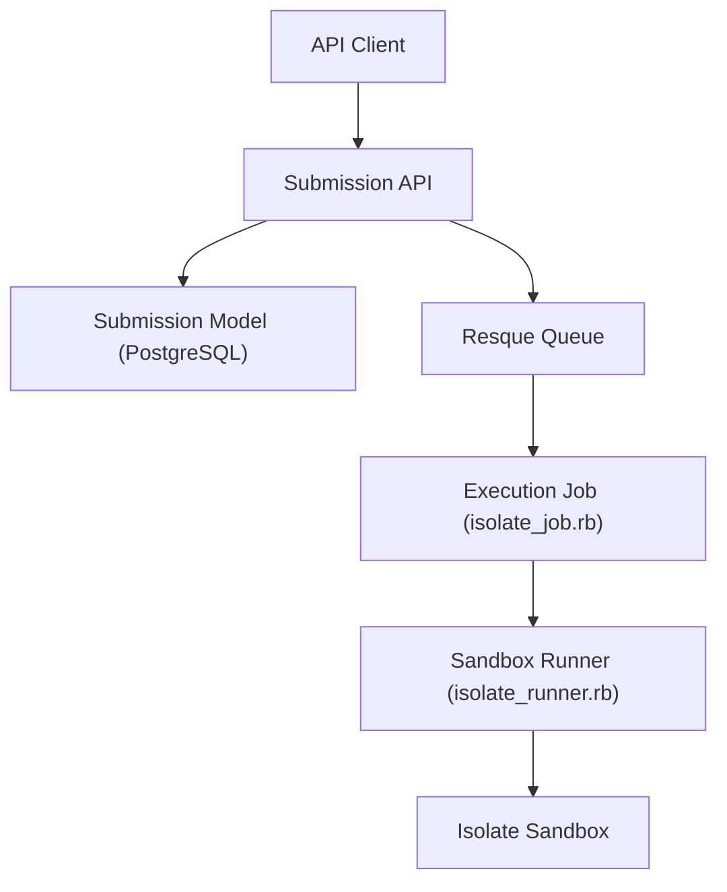

# judge0/judge0

> API HTTP d'exécution de code isolé, pour agents IA, plateformes d'exercices et éditeurs en ligne.

## Le problème
Exécuter du code non fiable (écrit par un utilisateur ou par un LLM) sans risque pour la machine hôte.

## Ce que ça fait vraiment
Reçoit du code source, une langue et des limites par HTTP JSON, l'exécute dans un bac à sable Isolate, de façon synchrone ou via une file Resque. Plus de 90 langages, projets multi-fichiers, webhooks. Résultats détaillés stockés dans PostgreSQL. Auto-hébergé ou service géré.

## Comment c'est branché
Schéma d'après le diagramme fourni.



## Essayer
```bash
curl \
  -H "Content-Type: application/json" \
  -d '{
      "language_id": 109,
      "source_code": "print(f\"hello, {input()}\")",
      "stdin": "Alice"
  }' \
  "https://ce.judge0.com/submissions?wait=true"
pip install judge0
```

## Coût et pièges
Auto-hébergement gratuit mais à sécuriser soi-même : des évasions de bac à sable (CVE) sont citées dans les références du README, donc maintenir à jour. Le service géré passe par RapidAPI ou un contrat. Licence GPL-3.0 (copyleft).

## Ce que ce n'est pas
Pas un interpréteur de code intégré à un LLM : c'est un service à déployer et durcir. Le README est surtout une liste de références.

## Alternatives
Aucune alternative nommée dans le README (des articles comparatifs avec E2B et Rustbox sont seulement listés).

## Pour toi
À surveiller : pratique pour donner un bac à sable de code à un agent, à condition d'isoler le réseau et de suivre les correctifs de sécurité.

