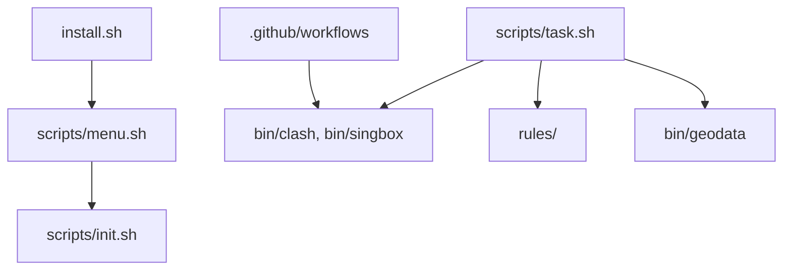

# juewuy/ShellCrash

> Shell script to install and manage the mihomo and sing-box cores on routers and Linux machines.

## The problem
Deploying a proxy core on a router or a small Linux box means managing binaries, rules, scheduled tasks and updates by hand.

## What it actually does
An interactive menu (`crash`) installs and switches between mihomo and sing-box, imports subscription links, schedules rule updates and offers a local web dashboard. It works in router mode or local mode. It relies on curl/wget, iptables/nftables and crontab.

## How it is wired


## Trying it
```sh
export url='https://testingcf.jsdelivr.net/gh/juewuy/ShellCrash@dev' \
  && wget -q --no-check-certificate -O /tmp/install.sh $url/install_en.sh \
  && bash /tmp/install.sh \
  && . /etc/profile &> /dev/null
crash
crash -h
```

## Cost and gotchas
Free, but root SSH access is required. The installation downloads a remote script with `--no-check-certificate` or `-k`: review it before running. The README also offers a "private" source from the author.

## What it is not
Not a proxy service: you must provide your own subscriptions or nodes. Not a data/AI tool. Documentation and blog mostly aimed at a Chinese audience.

## Alternatives
An official Docker image exists (Docker Hub), cited in the README; no other alternative named.

## For you
Ignore for a data/AI/MLOps profile: it is router network administration unrelated to your field, and it installs through a remote script that is hard to verify.
