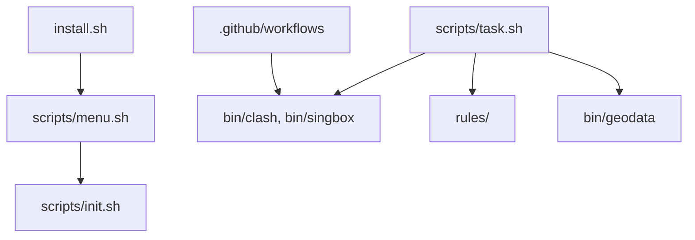

# juewuy/ShellCrash

> Script shell pour installer et piloter les noyaux mihomo et sing-box sur routeurs et machines Linux.

## Le problème
Déployer un noyau proxy sur un routeur ou un petit Linux demande de gérer binaires, règles, tâches planifiées et mises à jour à la main.

## Ce que ça fait vraiment
Un menu interactif (`crash`) installe et bascule entre mihomo et sing-box, importe des liens d'abonnement, planifie les mises à jour de règles et propose un tableau de bord web local. Il fonctionne en mode routeur ou en mode local. Il s'appuie sur curl/wget, iptables/nftables et crontab.

## Comment c'est branché


## Essayer
```sh
export url='https://testingcf.jsdelivr.net/gh/juewuy/ShellCrash@dev' \
  && wget -q --no-check-certificate -O /tmp/install.sh $url/install_en.sh \
  && bash /tmp/install.sh \
  && . /etc/profile &> /dev/null
crash
crash -h
```

## Coût et pièges
Gratuit, mais il faut un accès SSH root. L'installation télécharge un script distant avec `--no-check-certificate` ou `-k` : à relire avant d'exécuter. Le README propose aussi une source « privée » de l'auteur.

## Ce que ce n'est pas
Pas un service de proxy : il faut fournir ses propres abonnements ou nœuds. Pas un outil data/IA. Documentation et blog surtout orientés un public chinois.

## Alternatives
Une image Docker officielle existe (Docker Hub), citée dans le README ; aucune autre alternative nommée.

## Pour toi
À ignorer pour un profil data/IA/MLOps : c'est de l'administration réseau de routeur sans lien avec ton métier, et il s'installe par un script distant peu vérifiable.

