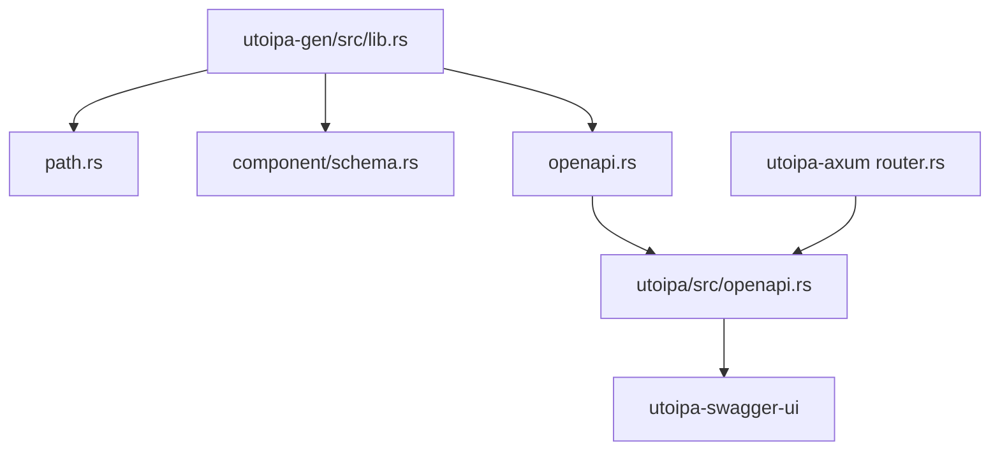

# juhaku/utoipa

> Rust library that generates an API's OpenAPI documentation from macros in the code.

## The problem
Writing an API's OpenAPI YAML or JSON by hand takes time and drifts from the code.

## What it actually does
You annotate types with `ToSchema` and functions with `#[utoipa::path(...)]`, declare them in `#[derive(OpenApi)]`, and `ApiDoc::openapi()` produces an OpenAPI 3.1 document. Bindings exist for actix-web, axum and rocket, as well as Swagger UI and Scalar. OpenAPI types can also be written by hand in Rust.

## How it is wired


## Trying it
```bash
# Cargo.toml
utoipa = "6"
```

## Cost and gotchas
Free. A Rust project is required. No automatic schema discovery: the README points to a third-party crate, utoipauto. Tuples, arrays and slices cannot be used as generic arguments.

## What it is not
It is not an API server: it documents. Integration with the web framework remains to be wired.

## Alternatives
No alternative named in the README (utoipauto is a cited complement, not a competitor).

## For you
Ignore: only useful if you expose an API in Rust, which falls outside a typical data, AI or MLOps profile.
