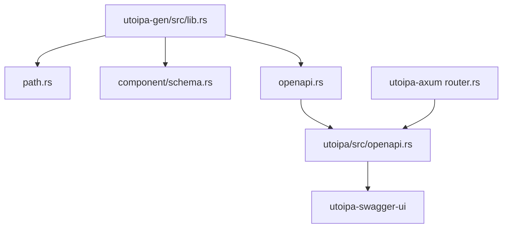

# juhaku/utoipa

> Bibliothèque Rust qui génère la documentation OpenAPI d'une API à partir de macros dans le code.

## Le problème
Écrire à la main le YAML ou JSON OpenAPI d'une API coûte du temps et dérive du code.

## Ce que ça fait vraiment
On annote les types avec `ToSchema` et les fonctions avec `#[utoipa::path(...)]`, on les déclare dans `#[derive(OpenApi)]`, et `ApiDoc::openapi()` produit un document OpenAPI 3.1. Des liaisons existent pour actix-web, axum et rocket, ainsi que Swagger UI et Scalar. Les types OpenAPI peuvent aussi être écrits à la main en Rust.

## Comment c'est branché


## Essayer
```bash
# Cargo.toml
utoipa = "6"
```

## Coût et pièges
Gratuit. Il faut un projet Rust. Pas de découverte automatique des schémas : le README renvoie à une caisse tierce, utoipauto. Tuples, tableaux et tranches ne peuvent pas servir d'arguments génériques.

## Ce que ce n'est pas
Ce n'est pas un serveur d'API : il documente. L'intégration au framework web reste à brancher.

## Alternatives
Aucune alternative nommée dans le README (utoipauto est un complément cité, pas un concurrent).

## Pour toi
À ignorer : utile seulement si tu exposes une API en Rust, ce qui sort d'un profil data, IA ou MLOps courant.

