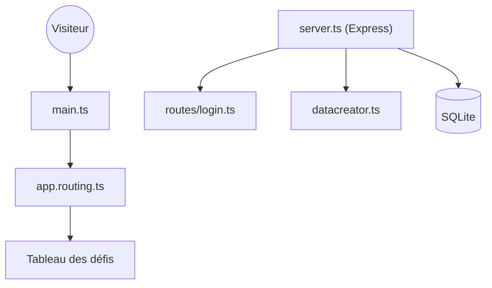

# juice-shop/juice-shop

> OWASP's deliberately vulnerable web shop, for security training and CTF exercises.

## The problem
Learning to spot web flaws on realistic cases requires a vulnerable application that is safe to attack at home.

## What it actually does
Angular application with an Express server and a SQLite database, covering the OWASP Top Ten and other real-world flaws. A dashboard tracks the challenges, with code challenges, a learning assistant, a chatbot and Web3 features. Some challenges need an AI provider (language model) to be configured.

## How it is wired


## Trying it
```bash
docker pull bkimminich/juice-shop
docker run --rm -p 127.0.0.1:3000:3000 bkimminich/juice-shop
git clone https://github.com/juice-shop/juice-shop.git --depth 1
npm install
npm start
```

## Cost and gotchas
Free. Node.js must match the supported versions (22, 24, 26). Keep the application on 127.0.0.1: it is vulnerable by design. The AI-related challenges require a provider to be configured, possibly paid.

## What it is not
Not a real shop, and not an attack tool: it is a training target. The demo instance is not meant to be attacked.

## Alternatives
- No alternative named in the README.

## For you
Watch: a good ground for training a team on web flaws or testing a scanner, notably its LLM-related challenges, but not useful for everyday data work.
