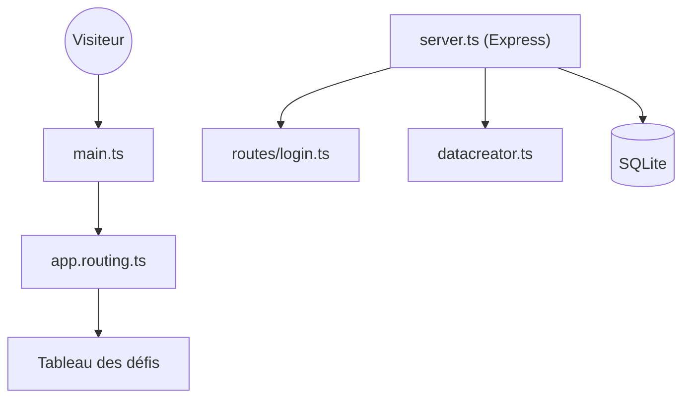

# juice-shop/juice-shop

> Boutique web volontairement vulnérable de l'OWASP, pour formations à la sécurité et exercices CTF.

## Le problème
Apprendre à repérer des failles web sur des cas réalistes exige une application vulnérable sûre à attaquer chez soi.

## Ce que ça fait vraiment
Application Angular avec serveur Express et base SQLite, qui reprend l'OWASP Top Ten et d'autres failles réelles. Un tableau de bord suit les défis, avec défis de code, assistant d'apprentissage, chatbot et fonctions Web3. Certains défis ont besoin d'un fournisseur d'IA (modèle de langage) à configurer.

## Comment c'est branché


## Essayer
```bash
docker pull bkimminich/juice-shop
docker run --rm -p 127.0.0.1:3000:3000 bkimminich/juice-shop
git clone https://github.com/juice-shop/juice-shop.git --depth 1
npm install
npm start
```

## Coût et pièges
Gratuit. Node.js doit correspondre aux versions prises en charge (22, 24, 26). Garde l'application sur 127.0.0.1 : elle est vulnérable par conception. Les défis liés à l'IA demandent un fournisseur à configurer, possiblement payant.

## Ce que ce n'est pas
Pas une vraie boutique, et pas un outil d'attaque : c'est une cible d'entraînement. L'instance de démonstration n'est pas faite pour y attaquer.

## Alternatives
- Aucune alternative nommée dans le README.

## Pour toi
À surveiller : bon terrain pour former une équipe aux failles web ou tester un scanner, notamment ses défis liés aux LLM, sans servir au travail data courant.

