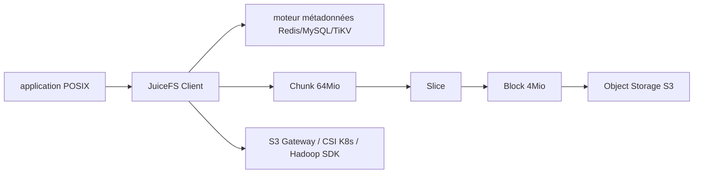

# juicedata/juicefs

> POSIX file system whose data lives in object storage.

## The problem
Object storage is cheap and unlimited, but data and ML applications
expect a POSIX file system, not an S3 API.

## What it actually does
Separates data and metadata: data goes to object storage (S3 and
compatibles, local disk, HDFS), metadata to an engine of your choice: Redis,
MySQL, SQLite, TiKV. Each file is split into Chunks of at most 64 MiB,
made of variable-length Slices, themselves made of 4 MiB Blocks stored
in the object store. POSIX compatible (8813 pjdfstest tests passed), compatible with Hadoop 2.x
and 3.x via a Java SDK, S3 gateway, Kubernetes CSI driver. Shareable by
thousands of clients with strong consistency: a confirmed modification is
immediately visible on all mount points. BSD (flock) and
POSIX (fcntl) global locks, encryption in transit and at rest, LZ4 or Zstandard compression.

## How it is wired


## Trying it
```bash
juicefs mount --no-usage-report
```

## Cost and gotchas
Apache 2.0, free. You must provide two services: a metadata engine and an object
bucket; their availability becomes the file system's availability. With Redis
Cluster, all keys of a transaction must land in the same hash slot,
so a file system uses only a single slot. Anonymous metrics collection
(version number) is on by default, disabled with `--no-usage-report`.

## What it is not
Not a view over existing files in a bucket: source files
are split and do not appear in the object storage browser, only
a `chunks` directory and numbered files. No recovery is possible without
the metadata.

## Alternatives
- EFS and S3FS: compared in the throughput and metadata IOPS benchmarks.
- MooseFS, HDFS, Google File System: cited as design inspirations.

## For you
The right answer when a training run or pipeline must read a dataset through POSIX
but you want to pay for object storage.
