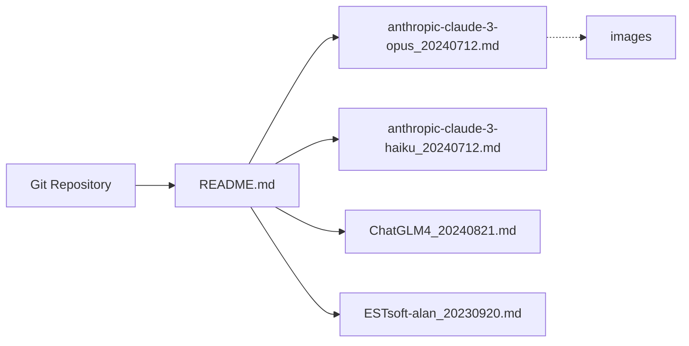

# jujumilk3/leaked-system-prompts

> Collection of leaked system prompts from consumer LLM services, for study and comparison.

## The problem
The system prompts of commercial assistants are opaque; studying them helps understand their guardrails and styles.

## What it actually does
Markdown files, one per prompt, named model + date (e.g. `anthropic-claude-3-opus_20240712.md`).
Contributions must cite a verifiable source or a reproducible prompt.
No code, no tooling: a repository of documents indexed by the README.

## How it is wired

## Trying it
No command documented.

## Cost and gotchas
Free. No license declared: reuse is legally unclear, content comes from leaks.

## What it is not
Not an official source, nor guaranteed up to date; the author avoids any sensitive commercial code to limit DMCA takedowns.

## Alternatives
No alternative named in the README.

## For you
Worth watching as reading material for writing your own system prompts, without building anything on it given the absence of a license.
