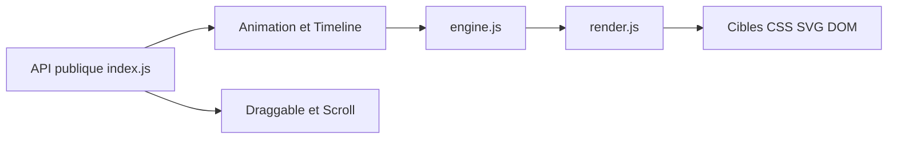

# juliangarnier/anime

> JavaScript animation library for CSS, SVG, DOM attributes and JS objects, aimed at front-end developers.

## The problem
Animating page elements (movements, sequences, scrolling) with pure CSS quickly becomes hard to orchestrate.

## What it actually does
Anime.js v4 is imported as ES modules: `animate`, `stagger`, with timelines, timers, easings, mouse dragging (draggable), scroll events, scopes, automatic layout, SVG and text tools, WAAPI and a Three.js adapter. The engine runs a refresh loop and renders the values onto the targets.

## How it is wired


## Trying it
```javascript
import {
  animate,
  stagger,
} from 'animejs';

animate('.square', {
  x: 320,
  rotate: { from: -180 },
  duration: 1250,
  delay: stagger(65, { from: 'center' }),
  ease: 'inOutQuint',
  loop: true,
  alternate: true
});
```

## Cost and gotchas
Free. v4 differs from v3: a migration guide exists.

## What it is not
It is not a data visualization library or a charting engine.

## Alternatives
No alternative named in the README.

## For you
Ignore: this is interface animation, unrelated to your data or AI work, unless you build a demo front end.
