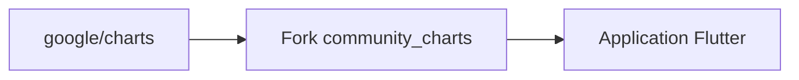

# juliansteenbakker/community_charts

> Community fork of google/charts, a charting library for Flutter.

## The problem
Google's original library is no longer the option Google maintains for Flutter charts.

## What it actually does
Takes over `google/charts`, a charting library for the Flutter mobile interface. The README says nothing more: chart types and examples are deferred to an online gallery. It is not an official Google product.

## How it is wired
Simplified diagram based on the sheet, no diagram provided.

## Trying it
No command documented in the README.

## Cost and gotchas
Free. Last push in August 2024. Flutter/Dart is actually required, not listed among the possible prerequisites.

## What it is not
Not a general-purpose dataviz tool: Flutter mobile only. Not official Google.

## Alternatives
- google/charts: the origin of the fork.

## For you
Ignore: Flutter charts are off topic for a data / AI profile, and the fork is barely active.
