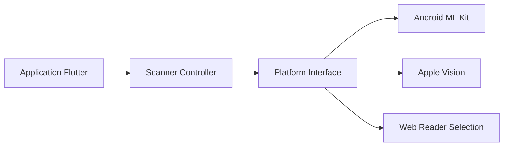

# juliansteenbakker/mobile_scanner

> Flutter plugin to read barcodes and QR codes with the camera, on mobile, macOS and web.

## The problem
Reading barcodes in a Flutter application across several platforms with a single codebase.

## What it actually does
- Real-time detection with several formats; configurable controller (resolution, torch, auto zoom, formats).
- Lens selection (`getBestCloseRangeScanningLens`), camera switching.
- Android: ML Kit, bundled version (3 to 10 MB) or unbundled.
- iOS and macOS: Vision. Web: native detector, zxing-wasm or ZXing-js.
- Documented limits on `rawBytes` depending on the platform.

## How it is wired


## Trying it
```bash
flutter pub get
```
```dart
MobileScanner(
  onDetect: (result) {
    print(result.barcodes.first.rawValue);
  },
),
```

## Cost and gotchas
Free. Info.plist keys required on iOS (`NSCameraUsageDescription`). The web version loads a WASM binary (about 2 MB) from a CDN, unless a mirror is configured.

## What it is not
Not a standalone reader: you need a Flutter application. `rawBytes` is not reliable everywhere on Apple.

## Alternatives
No alternative named in the README.

## For you
Ignore: mobile development, outside the data / AI / MLOps scope.
