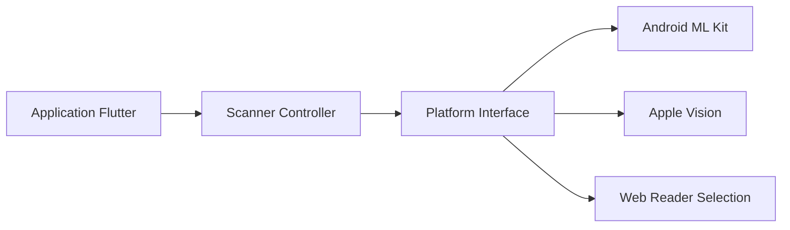

# juliansteenbakker/mobile_scanner

> Plugin Flutter pour lire codes-barres et QR codes avec la caméra, sur mobile, macOS et web.

## Le problème
Lire des codes-barres dans une application Flutter sur plusieurs plateformes avec un même code.

## Ce que ça fait vraiment
- Détection en temps réel avec plusieurs formats ; contrôleur configurable (résolution, torche, zoom automatique, formats).
- Sélection d'objectif (`getBestCloseRangeScanningLens`), bascule de caméra.
- Android : ML Kit, version embarquée (3 à 10 Mo) ou non embarquée.
- iOS et macOS : Vision. Web : détecteur natif, zxing-wasm ou ZXing-js.
- Limites documentées sur `rawBytes` selon la plateforme.

## Comment c'est branché


## Essayer
```bash
flutter pub get
```
```dart
MobileScanner(
  onDetect: (result) {
    print(result.barcodes.first.rawValue);
  },
),
```

## Coût et pièges
Gratuit. Clés Info.plist sur iOS (`NSCameraUsageDescription`). Le web charge un binaire WASM (environ 2 Mo) depuis un CDN, sauf mirroir configuré.

## Ce que ce n'est pas
Pas un lecteur autonome : il faut une application Flutter. `rawBytes` n'est pas fiable partout sur Apple.

## Alternatives
Aucune alternative nommée dans le README.

## Pour toi
À ignorer : développement mobile, hors périmètre data / IA / MLOps.

