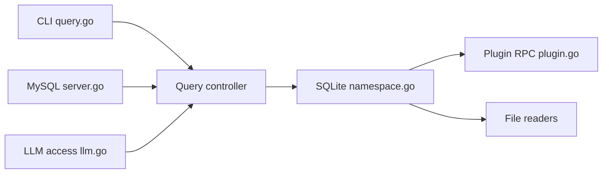

# julien040/anyquery

> SQL engine on SQLite for querying files, databases and applications via plugins, with MCP access for LLMs.

## The problem
Joining scattered data (files, Notion, Apple Notes, databases) takes as many scripts or exports.

## What it actually does
A SQL engine built on SQLite that reads files, databases and applications via plugins (official registry, SQLite extensions accepted). Interactive shell, MySQL-compatible server (TablePlus, Metabase…), and an MCP server (stdio or HTTP) so that LLMs can query your data. An `anyquery gpt` command prepares function-calling access.

## How it is wired


## Trying it
```bash
curl -fsSL https://anyquery.dev/install.sh | sh
anyquery
anyquery server &
anyquery mcp --stdio
```

## Cost and gotchas
Free; building from source requires Go 1.26+ and a C compiler. A license is present but not identified by GitHub: to be checked. Repository sponsored by Atlas Cloud (inference plugin).

## What it is not
Not a data warehouse: a query layer on SQLite, whose quality depends on the plugins.

## Alternatives
No alternative named in the README.

## For you
Adopt to quickly query heterogeneous sources in SQL or expose them to an LLM via MCP, checking the license first.
