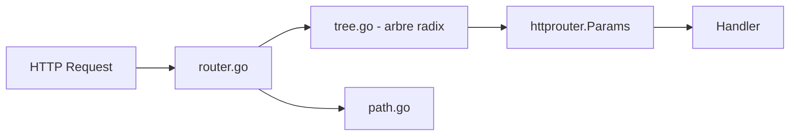

# julienschmidt/httprouter

> Lightweight Go HTTP router with a radix tree, for API developers who want unambiguous routes.

## The problem
The standard `net/http` mux handles neither path variables nor method distinction, and its precedence rules are confusing.

## What it actually does
A router implementing `http.Handler`, with one radix tree per HTTP method. Named parameters (`:name`) and catch-all (`*filepath`), a request matches only one route or none, automatic redirects on trailing slash, case correction, panic handler, automatic OPTIONS and 405 responses. The README claims zero allocations on the matching path (the author's claim).

## How it is wired


## Trying it
```bash
go get github.com/julienschmidt/httprouter
```
```go
router := httprouter.New()
router.GET("/", Index)
router.GET("/hello/:name", Hello)
log.Fatal(http.ListenAndServe(":8080", router))
```

## Cost and gotchas
Free. You cannot register `/user/new` and `/user/:user` for the same method. Last push in July 2024; 84 open issues.

## What it is not
It is not a framework: no built-in middleware (you chain `http.Handler`s). Parameters are passed through a third argument, except via the `http.Handler` API where they are in the context.

## Alternatives
Gin: martini-style API, built on httprouter, more complete. The README also cites other frameworks built on it (api2go, Jett, siesta...).

## For you
Keep an eye on it: sound for small Go APIs, but no recent activity and a single maintainer; in a data/AI profile, it is only useful if you expose a Go service.
