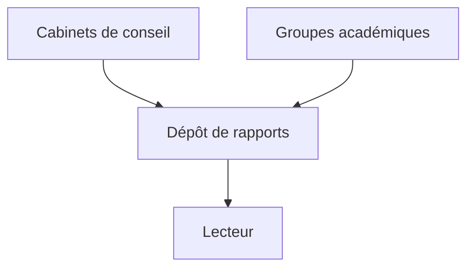

# juliocesarfort/public-pentesting-reports

> Collection of penetration test reports published by consultancies and academic groups.

## The problem
Finding real examples of pentest reports means searching firm by firm.

## What it actually does
Repository of public reports, maintained by Julio of Blaze Information Security, on a list started in 2015 by Arne Padmos. The README does not detail the content: undocumented beyond this description.

## How it is wired
Simplified diagram based on the sheet, no diagram provided.



## Trying it
```bash
# Aucune commande documentée.
```

## Cost and gotchas
Free. No license declared: the right to reuse the reports is not established.

## What it is not
Not a penetration testing tool: documents to read. The README is too short to judge coverage.

## Alternatives
The README points to a similar repository on threat modeling, not named here.

## For you
Ignore: offensive security is outside your scope, useful only to see the shape of an audit report.
