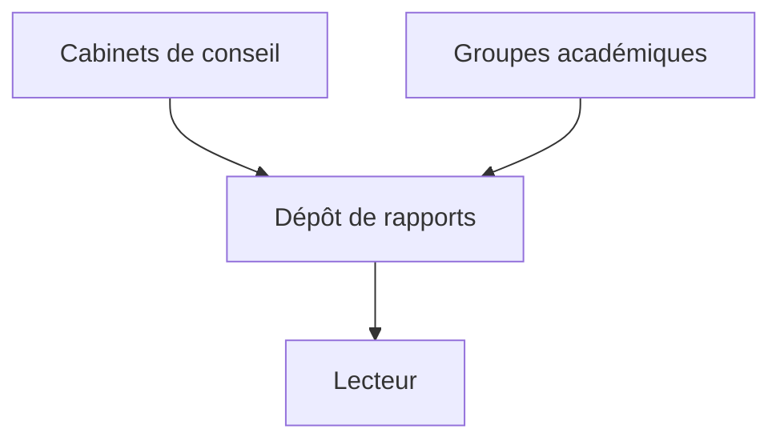

# juliocesarfort/public-pentesting-reports

> Recueil de rapports de tests d'intrusion publiés par des cabinets et des groupes académiques.

## Le problème
Trouver des exemples réels de rapports de pentest oblige à chercher cabinet par cabinet.

## Ce que ça fait vraiment
Dépôt de rapports publics, maintenu par Julio de Blaze Information Security, sur une liste lancée en 2015 par Arne Padmos. Le README ne détaille pas le contenu : non documenté au-delà de cette description.

## Comment c'est branché
Schéma simplifié d'après la fiche, sans diagramme fourni.



## Essayer
```bash
# Aucune commande documentée.
```

## Coût et pièges
Gratuit. Aucune licence déclarée : le droit de réutiliser les rapports n'est pas établi.

## Ce que ce n'est pas
Pas un outil de test d'intrusion : des documents à lire. Le README est trop court pour juger de la couverture.

## Alternatives
Le README renvoie vers un dépôt similaire sur la modélisation de menaces, sans le nommer ici.

## Pour toi
À ignorer : sécurité offensive hors de ton périmètre, utile seulement pour voir la forme d'un rapport d'audit.

