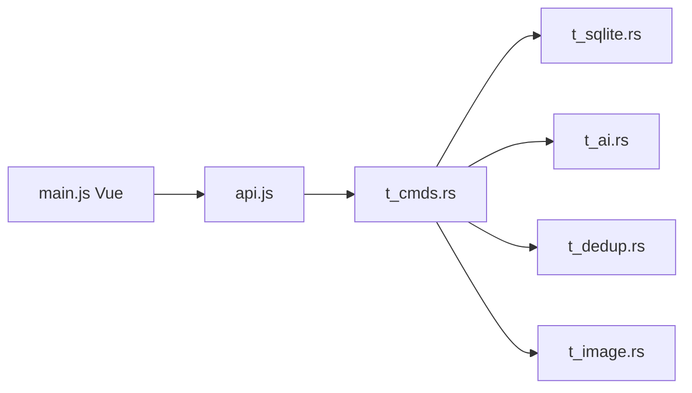

# julyx10/lap

> Local desktop photo manager, no cloud, with local AI search.

## The problem
Online photo services require uploading your files; managing 100,000 photos offline remains painful.

## What it actually does
Indexes existing folders into a local SQLite database, without moving them. Search by text and similarity (CLIP), faces (InsightFace), duplicates, smart albums, map, basic editing, 60+ formats including RAW and HEIC. Tauri/Rust, Vue front end; inference runs through ONNX Runtime. Tags, ratings and collections are not written into the files.

## How it is wired


## Trying it
```bash
brew tap julyx10/lap
brew install --cask lap
```

## Cost and gotchas
Free. Models are fetched with `./scripts/download_models.sh` when building. Windows build is unsigned (SmartScreen). Back up the database along with the photos: tags are not embedded in them. Some online services are optional (map).

## What it is not
Not a full RAW editor. Organization is tied to the Lap database: moving files outside Lap breaks it.

## Alternatives
No alternative named in the README.

## For you
Worth watching: a concrete example of embedded local AI (CLIP, faces, ONNX) in a desktop app, useful as an architecture reference.
