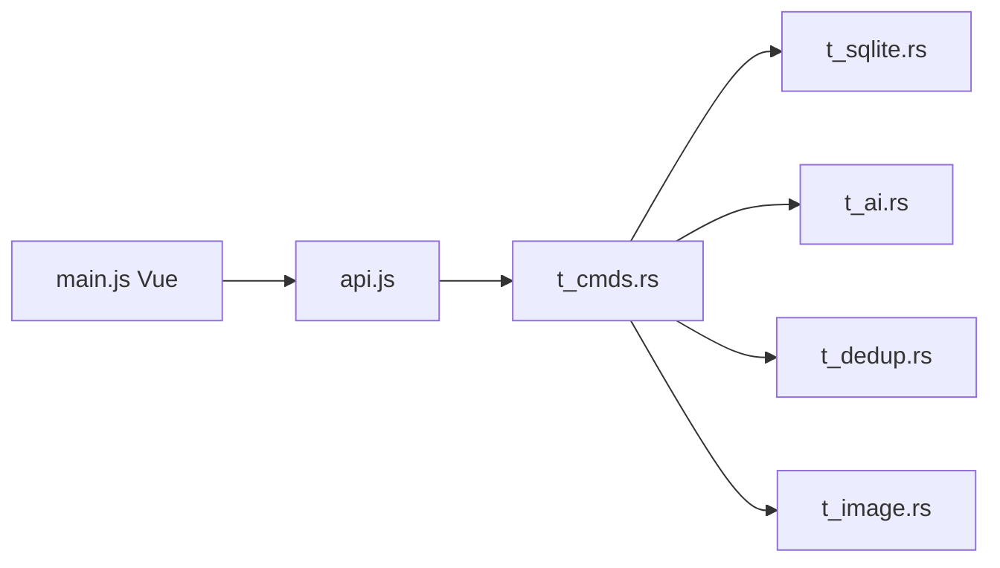

# julyx10/lap

> Gestionnaire de photos local de bureau, sans cloud, avec recherche IA locale.

## Le problème
Les services de photos en ligne imposent l'envoi des fichiers ; gérer 100 000 photos hors ligne reste pénible.

## Ce que ça fait vraiment
Indexe des dossiers existants dans une base SQLite locale, sans les déplacer. Recherche par texte et similarité (CLIP), visages (InsightFace), doublons, albums intelligents, carte, édition de base, 60+ formats dont RAW et HEIC. Tauri/Rust, frontend Vue ; l'inférence passe par ONNX Runtime. Tags, notes et collections ne sont pas écrits dans les fichiers.

## Comment c'est branché


## Essayer
```bash
brew tap julyx10/lap
brew install --cask lap
```

## Coût et pièges
Gratuit. Les modèles se récupèrent par `./scripts/download_models.sh` en compilation. Windows non signé (SmartScreen). Sauvegarder la base avec les photos : les tags n'y sont pas intégrés. Certains services en ligne sont optionnels (carte).

## Ce que ce n'est pas
Pas un éditeur RAW complet. L'organisation est liée à la base Lap : déplacer les fichiers hors de Lap la casse.

## Alternatives
Aucune alternative nommée dans le README.

## Pour toi
Surveiller : exemple concret d'IA locale embarquée (CLIP, visages, ONNX) dans une app de bureau, utile comme référence d'architecture.

