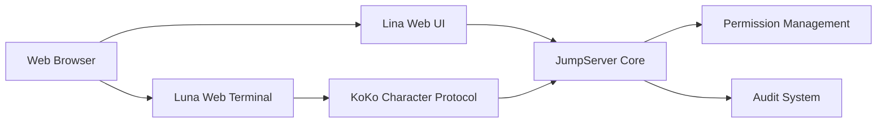

# jumpserver/jumpserver

> Open source privileged access management (PAM) bastion for DevOps and IT teams.

## The problem
Giving teams SSH, RDP, database or Kubernetes access without traceability or central control is risky.

## What it actually does
Django core (accounts, assets, permissions, audit, terminal) with the Lina web interface and the Luna web terminal.
Protocol connectors: KoKo (SSH, etc.), Chen (databases on the web), Kael (AI).
Session recording and audit; Enterprise components for RDP, VNC, databases, remote applications.

## How it is wired


## Trying it
```bash
curl -sSL https://github.com/jumpserver/jumpserver/releases/latest/download/quick_start.sh | bash
```

## Cost and gotchas
Linux server with 4 cores / 8 GB minimum. Default credentials `admin` / `ChangeMe` must be changed. Several protocol proxies are reserved for the Enterprise edition.

## What it is not
Not a data/AI tool. Not complete in the community edition for RDP/VNC/advanced databases.

## Alternatives
No alternative named in the README.

## For you
Out of scope, unless you manage access to infrastructure.
