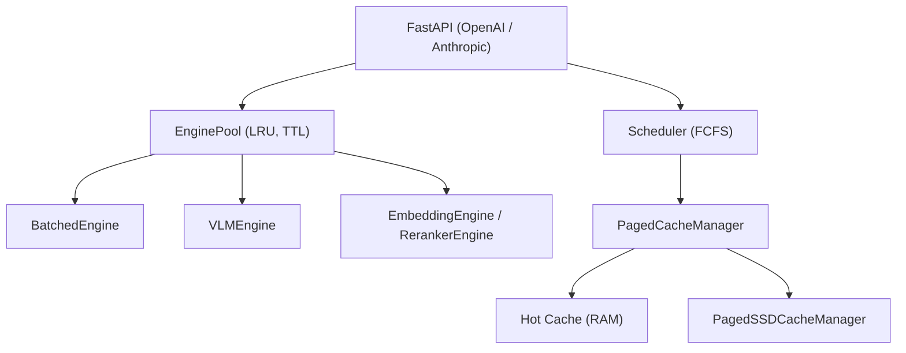

# jundot/omlx

> Local inference server for Apple Silicon, with persistent KV cache and a macOS menu bar app.

## The problem
Local LLM servers force you to choose between comfort and control: you can neither pin your everyday
models in memory, nor automatically swap out the heaviest ones, nor keep the context cache when the
conversation changes.

## What it actually does
An OpenAI- and Anthropic-compatible server (`/v1/chat/completions`, `/v1/messages`, `/v1/embeddings`,
`/v1/rerank`) that discovers LLMs, VLMs, OCR models, embeddings and rerankers in a folder. Two-tier KV
cache: hot tier in RAM, cold tier on SSD in safetensors, restored after a restart.
Continuous batching via mlx-lm's `BatchGenerator`, LRU eviction, model pinning, per-model TTL,
per-process memory cap. `/admin` dashboard with chat, benchmarks and a Hugging Face downloader.
Menu bar app in SwiftUI.

## How it is wired


## Trying it
```bash
brew tap jundot/omlx https://github.com/jundot/omlx
brew install jundot/omlx/omlx
omlx start
omlx serve --model-dir ~/models --paged-ssd-cache-dir ~/.omlx/cache
python -c "from omlx.custom_kernels import native_kernel_status; print(native_kernel_status())"
```

## Cost and gotchas
macOS 15.0+, Python 3.11–3.13, Apple Silicon required. Major pitfall: `pip install -e .` does not
build the Metal kernels, and the affected families silently fall back to a generic path — 845 versus ~29 tok/s measured
on an M3 Ultra for GLM-5.2, with more memory consumed.
Building them requires full Xcode. The server refuses to start on a non-loopback address without
an API key.

## What it is not
Not cross-platform: Apple Silicon only. Multi-Mac inference is explicitly experimental
and reserved for source builds. It is not a project started from scratch: it derives from
`vllm-mlx` v0.1.0, which the README acknowledges.

## Alternatives
- mlx-lm / mlx-vlm: the underlying Apple engines, if a server is not needed.
- vllm-mlx: the original project oMLX descends from.

## For you
The best local candidate on Mac for serving several models — provided you install via the DMG.
