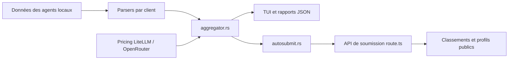

# junhoyeo/tokscale

> CLI and dashboard that add up tokens and costs across more than fifty coding agents, for those who multiply their use.

## The problem
Each coding agent (Claude Code, Codex, Cursor, Gemini CLI...) stores its sessions in its own corner. There is no way to know how many tokens and dollars you burn in total, per model, per project or per day.

## What it actually does
Reads the local session files (JSONL, SQLite, API caches) of dozens of clients, prices each message with LiteLLM then OpenRouter prices, and aggregates everything. Rendered as a Ratatui TUI, `--light` tables, JSON export, a 2D/3D contribution graph. Option to submit to a public leaderboard (tokscale.ai) and a task report summarized by an LLM of your choice.

## How it is wired


## Trying it
```bash
npx tokscale@latest
bunx tokscale@latest
npx tokscale@latest --light
tokscale models --json --group-by workspace,model --month
tokscale submit --dry-run
```

## Cost and gotchas
Free, local by default. The displayed cost is an "API equivalent" estimate, not a subscription bill. Claude Code sessions are purged after 30 days by default: disable that in `~/.claude/settings.json` to keep the history.

## What it is not
Not a billing tool: cloud usage (Claude Code web, Codex cloud) is not read. Clients like Cursor or Warp require synchronization with credentials. `submit` publishes aggregates to a public leaderboard.

## Alternatives
- ccusage: inspiration cited by the README, narrower.
- viberank: community leaderboard cited in the acknowledgements.

## For you
Adopt: if you run several coding agents, a single view of tokens and costs per project is useful to choose between models and watch the bill, with no API key or infra.
