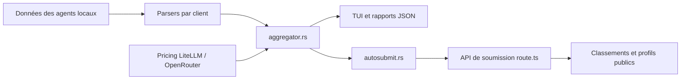

# junhoyeo/tokscale

> CLI et tableau de bord qui additionnent tokens et coûts de plus de cinquante agents de code, pour qui en multiplie l'usage.

## Le problème
Chaque agent de code (Claude Code, Codex, Cursor, Gemini CLI…) stocke ses sessions dans son coin. Impossible de savoir combien de tokens et de dollars on brûle au total, par modèle, par projet ou par jour.

## Ce que ça fait vraiment
Lit les fichiers de session locaux (JSONL, SQLite, caches d'API) de dizaines de clients, chiffre chaque message avec les prix LiteLLM puis OpenRouter, et agrège le tout. Rendu en TUI Ratatui, tableaux `--light`, export JSON, graphe de contributions 2D/3D. Option de soumission à un classement public (tokscale.ai) et rapport de tâches résumé par un LLM au choix.

## Comment c'est branché


## Essayer
```bash
npx tokscale@latest
bunx tokscale@latest
npx tokscale@latest --light
tokscale models --json --group-by workspace,model --month
tokscale submit --dry-run
```

## Coût et pièges
Gratuit, local par défaut. Le coût affiché est une estimation « équivalent API », pas la facture d'un abonnement. Les sessions Claude Code sont purgées après 30 jours par défaut : à désactiver dans `~/.claude/settings.json` pour garder l'historique.

## Ce que ce n'est pas
Pas un outil de facturation : les usages cloud (Claude Code web, Codex cloud) ne sont pas lus. Des clients comme Cursor ou Warp demandent une synchronisation avec identifiants. `submit` publie des agrégats sur un classement public.

## Alternatives
- ccusage : inspiration citée par le README, plus étroit.
- viberank : classement communautaire cité en remerciements.

## Pour toi
À adopter : si tu pilotes plusieurs agents de code, une vue unique des tokens et des coûts par projet est utile pour arbitrer les modèles et surveiller la facture, sans clé d'API ni infra.

