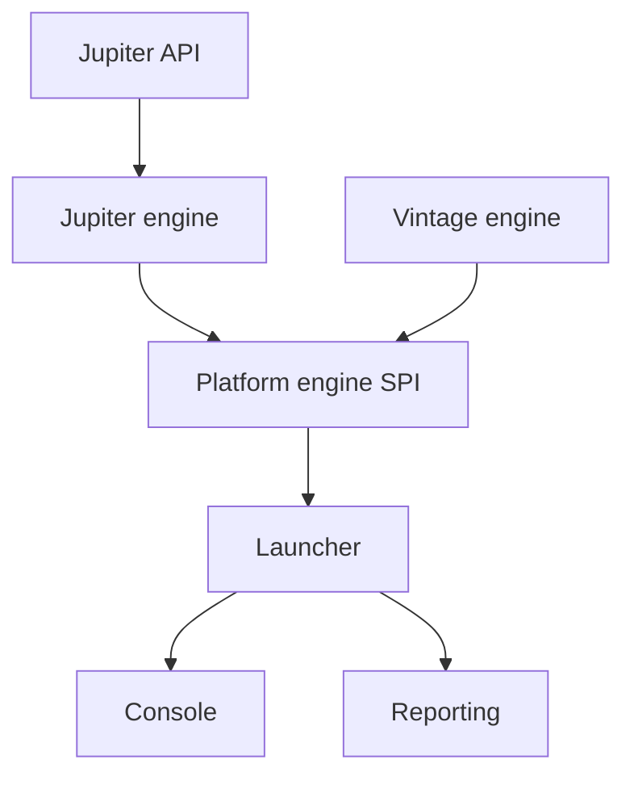

# junit-team/junit-framework

> Repository of JUnit Platform, Jupiter and Vintage: the standard testing framework of the Java ecosystem.

## The problem
Write, discover and run Java tests in a uniform way across IDEs and build tools.

## What it actually does
Three products: Platform (SPI engine, launcher, console, reports, suites), Jupiter (test API and extensions, parameterized tests) and Vintage (runs JUnit 3 and 4 on the Platform). Gradle monorepo with BOM and integration tests. Latest GA version indicated: JUnit 6.1.3 (August 7, 2026).

## How it is wired
Diagram taken from the code, reduced.



## Trying it
```bash
./gradlew build
./gradlew publishToMavenLocal
./gradlew clean jacocoRootReport
```

## Cost and gotchas
Free. Real requirement: JDK 25 to build; Java is missing from the prerequisites list. EPL-2.0 license, with its own clauses (weak copyleft), to be read before modified redistribution.

## What it is not
Not a tool to use directly from this repository: you consume the Maven artifacts. Not a Python test framework.

## Alternatives
No alternative named in the README.

## For you
Ignore unless you have a Java project: for your Python tests, pytest meets the need with no link to this repository.
