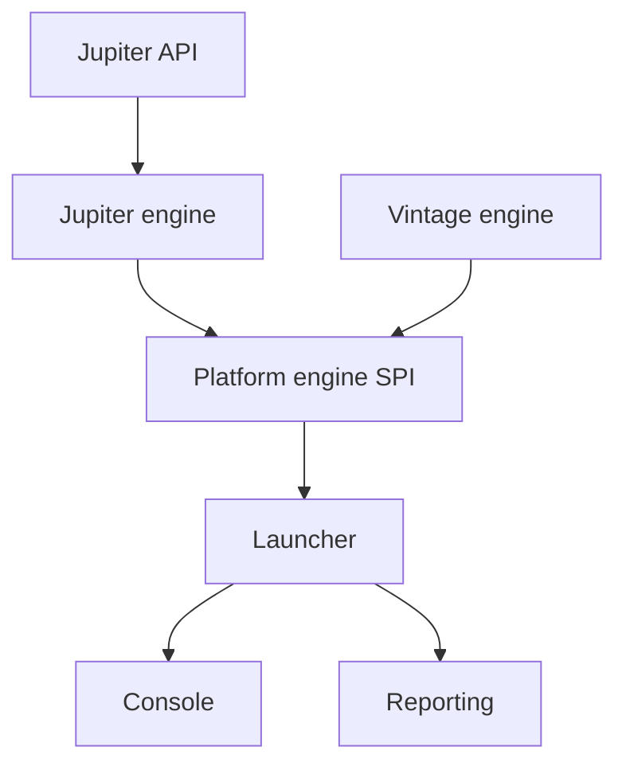

# junit-team/junit-framework

> Dépôt de JUnit Platform, Jupiter et Vintage : le cadre de tests standard de l'écosystème Java.

## Le problème
Écrire, découvrir et exécuter des tests Java de façon uniforme dans les IDE et les outils de build.

## Ce que ça fait vraiment
Trois produits : Platform (moteur SPI, launcher, console, rapports, suites), Jupiter (API de tests et extensions, tests paramétrés) et Vintage (exécute JUnit 3 et 4 sur la Platform). Monorepo Gradle avec BOM et tests d'intégration. Dernière version GA indiquée : JUnit 6.1.3 (7 août 2026).

## Comment c'est branché
Diagramme tiré du code, réduit.



## Essayer
```bash
./gradlew build
./gradlew publishToMavenLocal
./gradlew clean jacocoRootReport
```

## Coût et pièges
Gratuit. Besoin réel : JDK 25 pour compiler ; Java est absent de la liste des prérequis. Licence EPL-2.0, avec clauses propres (copyleft faible), à lire avant redistribution modifiée.

## Ce que ce n'est pas
Pas un outil à utiliser en direct depuis ce dépôt : on consomme les artefacts Maven. Pas un cadre de test Python.

## Alternatives
Aucune alternative nommée dans le README.

## Pour toi
À ignorer sauf projet Java : pour tes tests Python, pytest répond au besoin sans lien avec ce dépôt.

