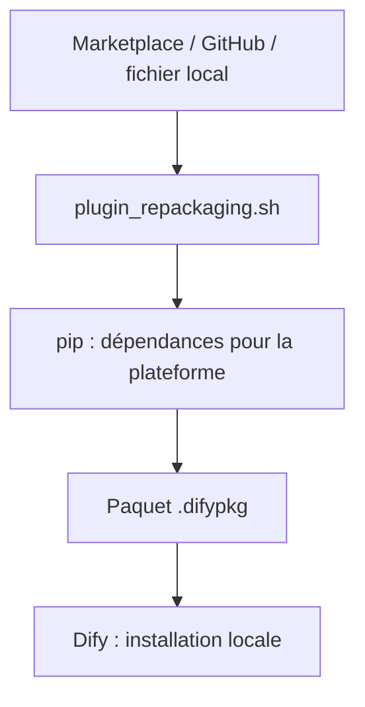

# junjiem/dify-plugin-repackaging

> Script that downloads and repackages Dify plugins with their dependencies, for offline installation.

## The problem
Installing a Dify plugin on an air-gapped platform fails when its Python dependencies cannot be downloaded on site.

## What it actually does
`plugin_repackaging.sh` fetches a plugin from the Marketplace, GitHub or a local file, downloads its dependencies for a given pip platform and produces a `.difypkg` package installable locally. It works through GitHub Actions or Docker.

## How it is wired
Simplified diagram based on the sheet, no diagram provided.



## Trying it
```bash
git clone https://github.com/junjiem/dify-plugin-repackaging.git
./plugin_repackaging.sh market langgenius agent 0.0.9
./plugin_repackaging.sh local ./db_query.difypkg
docker build -t dify-plugin-repackaging .
docker run -v $(pwd):/app dify-plugin-repackaging
```

## Cost and gotchas
The script uses `yum` to install `unzip`: on another distribution, install it beforehand. Python must match the one used by `dify-plugin-daemon` (3.12.x). The README recommends `FORCE_VERIFYING_SIGNATURE=false`, which disables plugin signature verification.

## What it is not
Not a plugin development tool nor Dify itself. No license is declared: reuse rights are uncertain.

## Alternatives
No alternative cited in the README.

## For you
Worth watching: useful only if you operate Dify in a closed environment, and the lack of a license calls for caution.
