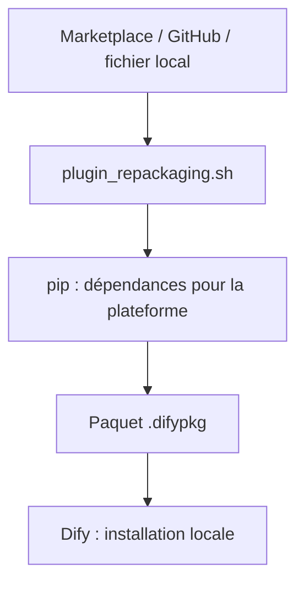

# junjiem/dify-plugin-repackaging

> Script qui télécharge et reconditionne les plugins Dify avec leurs dépendances, pour installation hors ligne.

## Le problème
Installer un plugin Dify sur une plateforme isolée échoue quand ses dépendances Python ne peuvent pas être téléchargées sur place.

## Ce que ça fait vraiment
`plugin_repackaging.sh` récupère un plugin depuis le Marketplace, GitHub ou un fichier local, télécharge ses dépendances pour une plateforme pip donnée et produit un paquet `.difypkg` installable en local. Il fonctionne via GitHub Actions ou Docker.

## Comment c'est branché
Schéma simplifié d'après la fiche, sans diagramme fourni.



## Essayer
```bash
git clone https://github.com/junjiem/dify-plugin-repackaging.git
./plugin_repackaging.sh market langgenius agent 0.0.9
./plugin_repackaging.sh local ./db_query.difypkg
docker build -t dify-plugin-repackaging .
docker run -v $(pwd):/app dify-plugin-repackaging
```

## Coût et pièges
Le script utilise `yum` pour installer `unzip` : sur une autre distribution, installe-le d'avance. Python doit correspondre à celui de `dify-plugin-daemon` (3.12.x). Le README conseille `FORCE_VERIFYING_SIGNATURE=false`, ce qui désactive la vérification des signatures de plugins.

## Ce que ce n'est pas
Pas un outil de développement de plugins ni de Dify lui-même. Aucune licence n'est déclarée : droit de réutilisation incertain.

## Alternatives
Aucune alternative citée dans le README.

## Pour toi
À surveiller : utile seulement si tu opères Dify en environnement fermé, et l'absence de licence invite à la prudence.

