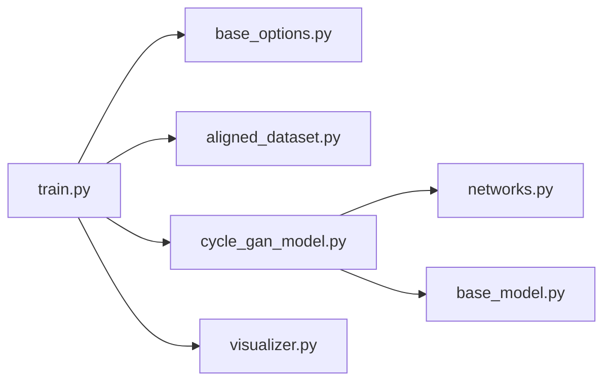

# junyanz/pytorch-CycleGAN-and-pix2pix

> Reference PyTorch implementation of CycleGAN and pix2pix for image-to-image translation.

## The problem
Reproducing image-translation GANs (paired or unpaired) requires consistent loaders, architectures and a training loop.

## What it actually does
`train.py` / `test.py` driven by CLI options: `--model cycle_gan|pix2pix|colorization|test`, `--dataset_mode`.
Paired, unpaired and single loaders; generators/discriminators in `networks.py`.
Checkpoints in `checkpoints/`, results as HTML, optional W&B tracking.
2025 update: Python 3.11, PyTorch 2.4, multi-GPU DDP via `torchrun`.

## How it is wired


## Trying it
```bash
git clone https://github.com/junyanz/pytorch-CycleGAN-and-pix2pix
cd pytorch-CycleGAN-and-pix2pix
conda env create -f environment.yml
bash ./datasets/download_cyclegan_dataset.sh maps
python train.py --dataroot ./datasets/maps --name maps_cyclegan --model cycle_gan
```

## Cost and gotchas
Free; CUDA GPU recommended. `--norm batch` is incompatible with DDP. Last push August 2025.

## What it is not
Not state of the art: the authors point to img2img-turbo and CUT. Research code, no inference service.

## Alternatives
- img2img-turbo: one-step translation based on SD-Turbo, better results according to the authors.
- contrastive-unpaired-translation (CUT): unpaired, faster and more economical.

## For you
Ignore for a new project: the authors themselves recommend their successors; useful only as GAN teaching material.
