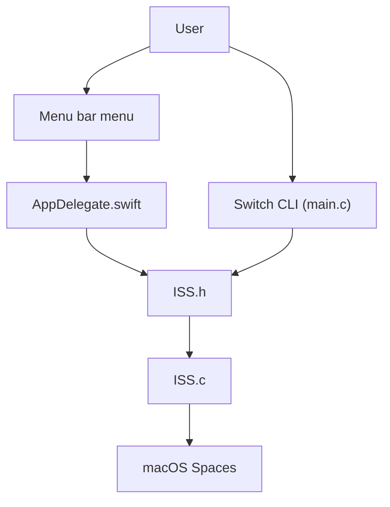

# jurplel/InstantSpaceSwitcher

> macOS application that removes the virtual desktop switching animation.

## The problem
On a high-refresh-rate display, the macOS space-switching animation gets longer and wastes time.

## What it actually does
A menu bar application and a command line (ISSCli) send a request to the ISS C API, which synthesizes a very-high-speed trackpad gesture to skip the animation. It supports configurable global shortcuts and an on-screen display. SIP does not need to be disabled.

## How it is wired


## Trying it
```bash
brew install --cask jurplel/tap/instant-space-switcher
git clone https://github.com/jurplel/InstantSpaceSwitcher
cd InstantSpaceSwitcher
./dist/build.sh
```

## Cost and gotchas
Free. The application is not signed, for lack of a paid Apple developer account: macOS may block it. It relies on a workaround for the animation.

## What it is not
It is not a window manager nor a productivity tool like Rectangle. It is not an official fix.

## Alternatives
No alternative named in the README.

## For you
Ignore: macOS comfort unrelated to data, AI or MLOps work, even if harmless.
