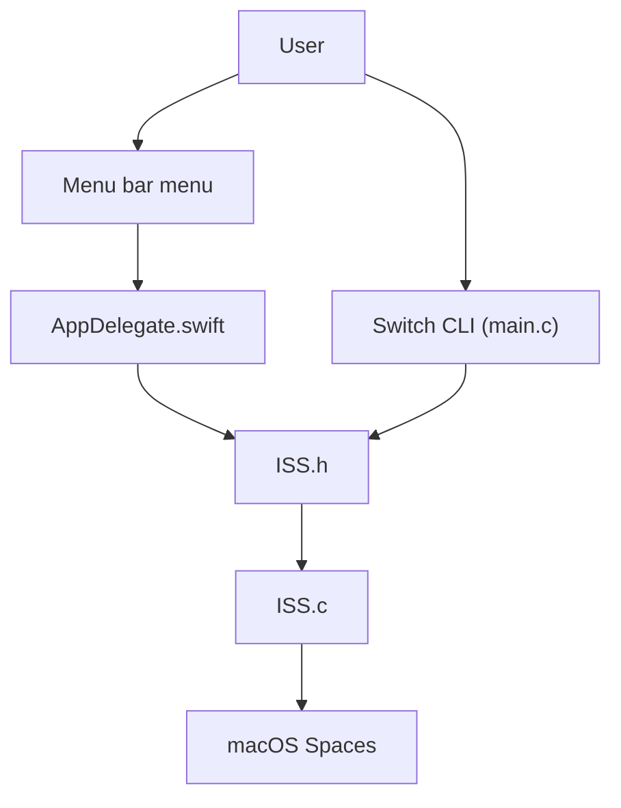

# jurplel/InstantSpaceSwitcher

> Application macOS qui supprime l'animation de changement de bureau virtuel.

## Le problème
Sur un écran à haute fréquence, l'animation de changement d'espace macOS s'allonge et fait perdre du temps.

## Ce que ça fait vraiment
Une application de barre de menus et une ligne de commande (ISSCli) envoient une demande à l'API C ISS, qui synthétise un geste de trackpad à très haute vitesse pour sauter l'animation. Elle gère des raccourcis globaux configurables et un affichage à l'écran. SIP n'a pas besoin d'être désactivé.

## Comment c'est branché


## Essayer
```bash
brew install --cask jurplel/tap/instant-space-switcher
git clone https://github.com/jurplel/InstantSpaceSwitcher
cd InstantSpaceSwitcher
./dist/build.sh
```

## Coût et pièges
Gratuit. L'application n'est pas signée, faute de compte développeur Apple payant : macOS peut la bloquer. Elle repose sur un contournement de l'animation.

## Ce que ce n'est pas
Ce n'est pas un gestionnaire de fenêtres ni un outil de productivité à la Rectangle. Ce n'est pas un correctif officiel.

## Alternatives
Aucune alternative nommée dans le README.

## Pour toi
À ignorer : confort macOS sans lien avec le travail data, IA ou MLOps, même s'il est inoffensif.

