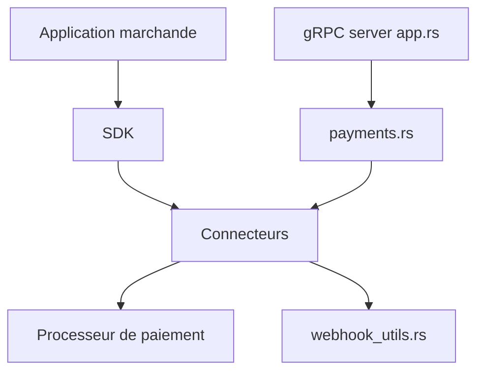

# juspay/hyperswitch-prism

> Stateless library for calling several payment processors through a single request schema.

## The problem
Every payment processor has its own APIs, error codes and authentication; switching providers forces you to rewrite the integration.

## What it actually does
Translates a unified request to the chosen connector (Stripe, Adyen, etc.) then normalizes the response. No database, no storage of personal data and no built-in vault. Available as an SDK (Node, Python, Java, Rust) or as a Docker gRPC server with Prometheus metrics. No routing or retries: those live in Hyperswitch.

## How it is wired


## Trying it
```bash
npm install hyperswitch-prism
pip install hyperswitch-prism
docker run --rm -p 8000:8000 ghcr.io/juspay/hyperswitch-prism:latest
```

## Cost and gotchas
Free, but you need an account and keys with each processor. Transaction fees remain your responsibility. No card vault: PCI compliance is yours to handle.

## What it is not
Not an orchestration platform: no routing, no retries, no tokenization. The README mentions an ambition to go beyond payments, not yet realized.

## Alternatives
- Juspay Hyperswitch: platform with smart routing and retries.

## For you
Ignore: payment integration, unrelated to data, AI or MLOps work.
