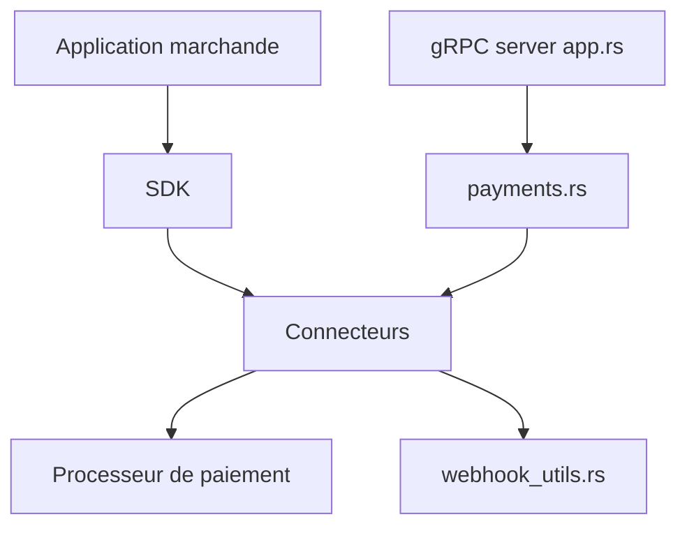

# juspay/hyperswitch-prism

> Bibliothèque sans état pour appeler plusieurs processeurs de paiement via un schéma de requête unique.

## Le problème
Chaque processeur de paiement a ses API, codes d'erreur et authentifications ; changer de fournisseur oblige à réécrire l'intégration.

## Ce que ça fait vraiment
Traduit une requête unifiée vers le connecteur choisi (Stripe, Adyen, etc.) puis normalise la réponse. Sans base de données, sans stockage de données personnelles ni coffre intégré. Disponible en SDK (Node, Python, Java, Rust) ou en serveur gRPC Docker avec métriques Prometheus. Pas de routage ni de nouvelles tentatives : ils vivent dans Hyperswitch.

## Comment c'est branché


## Essayer
```bash
npm install hyperswitch-prism
pip install hyperswitch-prism
docker run --rm -p 8000:8000 ghcr.io/juspay/hyperswitch-prism:latest
```

## Coût et pièges
Gratuit, mais il faut un compte et des clés chez chaque processeur. Les frais de transaction restent à ta charge. Pas de coffre de cartes : conformité PCI à gérer.

## Ce que ce n'est pas
Pas une plateforme d'orchestration : ni routage, ni reprise, ni tokenisation. Le README évoque l'ambition d'aller au-delà des paiements, pas encore réalisée.

## Alternatives
- Juspay Hyperswitch : plateforme avec routage et reprises intelligentes.

## Pour toi
Ignorer : de l'intégration de paiement, sans lien avec un travail data, IA ou MLOps.

