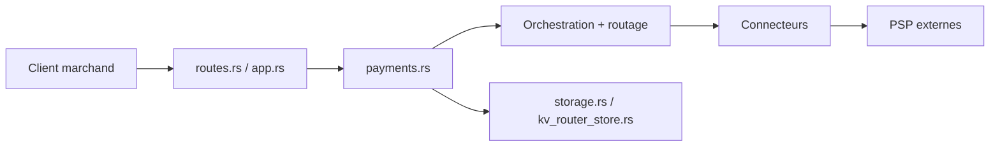

# juspay/hyperswitch

> Modular payment infrastructure in Rust: multi-PSP routing, escrow, chargeback, reconciliation, for product teams.

## The problem
Using a single payment gateway (such as Stripe or Braintree) can isolate the team and make it expensive to switch processors, manage unpaid invoices, and conduct audits of expenses.

## What it actually does
A Rust application server exposes the payment API and routes each transaction to one of over 120+ processors. Key features: intelligent routing, payment retry, PCI-compliant vault (with BYO-vault VGS/TokenEx), reconciliation, and cost visibility. A Control Center (ReScript) serves as a dashboard; web and mobile SDKs are provided.

## How it is wired


## Trying it
```bash
git clone --depth 1 --branch latest https://github.com/juspay/hyperswitch
cd hyperswitch
scripts/setup.sh
```
Proposed profiles: Standard, Full, Minimal. The sandbox environment is also described.

## Cost and gotchas
Free for self-hosting, but requires accounts with each PSP (Payment Service Provider). The PCI compliance aspect falls on the user to manage. Cloud deployment via Helm (AWS, GCP, Azure).

## What it is not
Not just a simple SDK wrapper: it's a platform to be used. Not a data analysis tool. The README refers to "commercial open-source": a paid-for Juspay service exists alongside it.

## Alternatives
- hyperswitch-prism: a connector library without the full switch.
- decision engine: only routing, standalone.

## For you
Monitoring: useful only if you are building a payment flow; outside the direct data/AI scope, but the routing engine based on success rates is a valuable resource.
