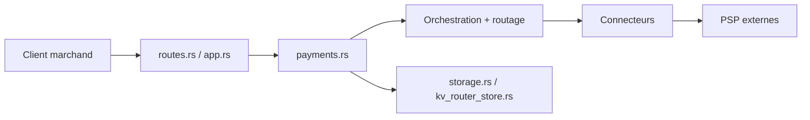

# juspay/hyperswitch

> Infrastructure de paiement modulaire en Rust : routage multi-PSP, coffre, relance, réconciliation, pour équipes produit.

## Le problème
Brancher un seul PSP (Stripe, Braintree…) enferme l'équipe et rend coûteux le changement de processeur, les relances d'impayés et l'audit des frais.

## Ce que ça fait vraiment
Un serveur d'application Rust expose l'API de paiement et route chaque transaction vers un connecteur parmi 120+ processeurs. Modules indépendants : routage intelligent, relance de paiements, coffre PCI (avec BYO-vault VGS/TokenEx), réconciliation, observabilité des coûts. Un Control Center (ReScript) sert de tableau de bord ; SDK web et mobiles fournis.

## Comment c'est branché


## Essayer
```bash
git clone --depth 1 --branch latest https://github.com/juspay/hyperswitch
cd hyperswitch
scripts/setup.sh
```
Profils proposés : Standard, Full, Minimal. Bac à sable hébergé aussi décrit.

## Coût et pièges
Gratuit en auto-hébergement, mais il faut des comptes chez chaque PSP. Le coffre PCI implique des obligations de conformité à ta charge. Déploiement cloud via Helm (AWS, GCP, Azure).

## Ce que ce n'est pas
Pas un simple wrapper de SDK : c'est une pile à exploiter. Pas un outil d'analyse de données. Le README parle de « commercial open-source » : une offre payante Juspay existe à côté.

## Alternatives
- hyperswitch-prism : bibliothèque de connecteurs sans le switch complet.
- decision-engine : seul le routage, autonome.

## Pour toi
Surveiller : utile seulement si tu bâtis un flux de paiement ; hors périmètre data/IA direct, mais le moteur de routage par taux de succès est une lecture instructive.

