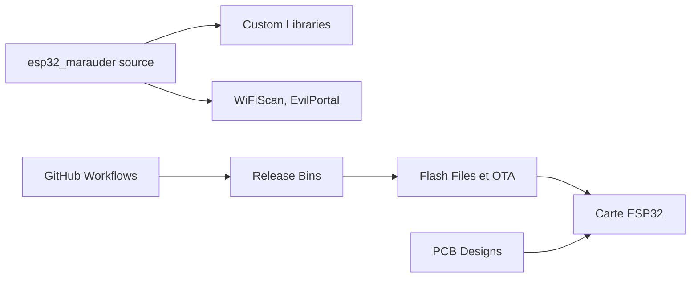

# justcallmekoko/ESP32Marauder

> Firmware for ESP32 boards: offensive and defensive WiFi and Bluetooth tools, for authorized security testing.

## The problem
Assessing the wireless security of a network usually requires scattered hardware and software.

## What it actually does
Based on the code architecture: a modular Arduino/C++ firmware (WiFiScan, CommandLine, Display, Settings, GPS, EvilPortal, asynchronous web server) for ESP32. The repository also contains the board files (PCB, enclosures, CAD), release binaries and an OTA update tool. The README is nearly empty: the precise features are not documented here, with a pointer to the wiki.

## How it is wired

## Trying it
No command in the README: download the latest firmware release and consult the wiki.

## Cost and gotchas
The firmware is free to download, but the hardware is sold (purchase link). No license declared: reuse rights are uncertain.

## What it is not
Not a consumer tool. It must only be used on networks and devices you are authorized to test: use without consent is illegal in most countries. No usage documentation in the repository.

## Alternatives
None named in the README.

## For you
Ignore: outside your data / AI / MLOps scope, with no license and no usable README.
