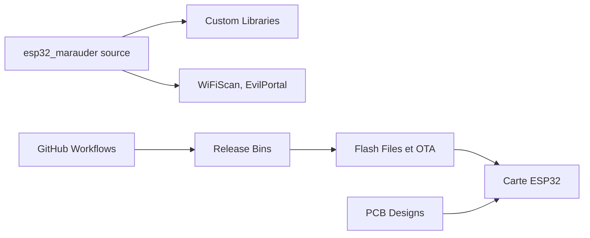

# justcallmekoko/ESP32Marauder

> Firmware pour carte ESP32 : outils WiFi et Bluetooth offensifs et défensifs, pour tests de sécurité autorisés.

## Le problème
Évaluer la sécurité sans fil d'un réseau demande habituellement du matériel et des logiciels dispersés.

## Ce que ça fait vraiment
D'après l'architecture du code : firmware Arduino/C++ modulaire (WiFiScan, CommandLine, Display, Settings, GPS, EvilPortal, serveur web asynchrone) pour ESP32. Le dépôt contient aussi les fichiers de cartes (PCB, boîtiers, CAD), des binaires de release et un outil de mise à jour OTA. Le README est quasi vide : les fonctions précises ne sont pas documentées ici, renvoi au wiki.

## Comment c'est branché

## Essayer
Aucune commande dans le README : télécharger la dernière release du firmware et consulter le wiki.

## Coût et pièges
Firmware gratuit à télécharger, mais le matériel est vendu (lien d'achat). Aucune licence déclarée : droits de réutilisation incertains.

## Ce que ce n'est pas
Ce n'est pas un outil grand public. Il ne doit servir que sur des réseaux et appareils dont tu as l'autorisation : l'usage sans accord est illégal dans la plupart des pays. Pas de documentation d'usage dans le dépôt.

## Alternatives
Aucune nommée dans le README.

## Pour toi
À ignorer : hors de ton périmètre data / IA / MLOps, sans licence ni README exploitable.

