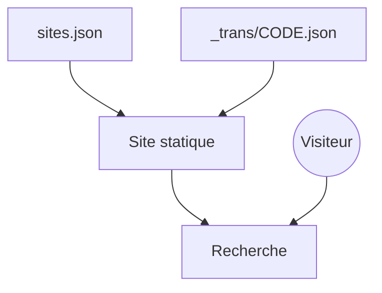

# justdeleteme/justdelete.me

> Directory of direct links to delete your account on web services, for any internet user.

## The problem
Services hide the account deletion page, and you waste time looking for how to leave.

## What it actually does
The repository contains `sites.json`, the list of services with a direct link (or help article) and a difficulty rating, plus translations in `_trans/`. The README only describes contribution rules: updating the repository, alphabetical order, 4-space indentation, JSON validation.

## How it is wired
Simplified diagram based on the sheet, no diagram provided.

## Trying it
No command documented, apart from `git pull` before contributing.

## Cost and gotchas
Free. Last push in June 2024 and more than 150 open issues: links may be outdated.

## What it is not
It is not a service that deletes accounts for you: it only points to the pages. It is not guaranteed to be up to date.

## Alternatives
No alternative named in the README.

## For you
Ignore: a consumer directory unrelated to data or MLOps, and with no recent activity.
